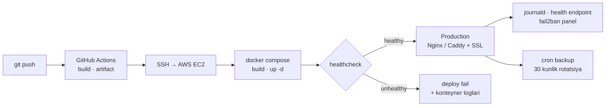
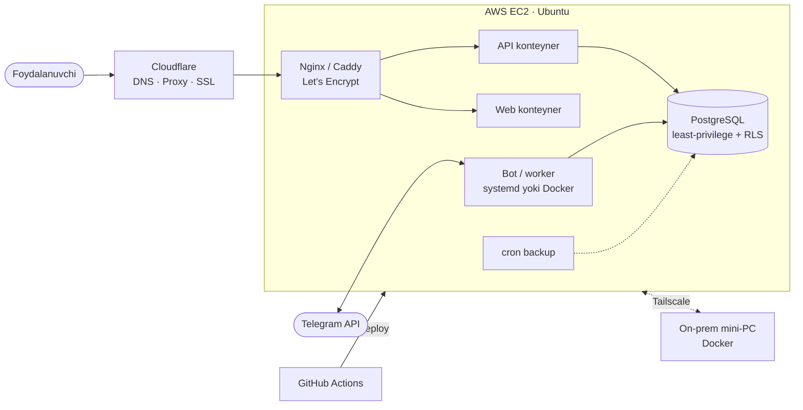

<div align="center">


<a href="https://git.io/typing-svg"></a>

<a href="mailto:ourty77@gmail.com"></a>
<a href="https://t.me/isroilovxk"></a>


</div>

<br/>

```yaml
$ whoami
name:        Abduraxmon Isroilov
role:        Tizim administratori · DevOps
experience:
  - 3y 7m   IT sohasida amaliy tajriba
  - 1y 6m   Tizim administratori        @ O‘zR Yoshlar ishlari agentligi
  - 2y 1m   O‘qituvchi / SysAdmin        @ HAAD Learning Center (axborot xavfsizligi)
infra:       8+ loyiha AWS EC2 da — deploy, xavfsizlik, monitoring, backup o‘zimda
education:   Turan International University — Software Engineering (4-kurs)
languages:   [ O‘zbek — ona tili, English — B2, Русский — bazaviy ]
approach:    root cause > workaround · takroriy ish → avtomatlashtirish
```

### `01` &nbsp;Yo‘nalishlar

<table>
<tr>
<td width="50%" valign="top">

**Tizimlar va infratuzilma**<br/>
Windows / Linux serverlar va ish stansiyalari · OS, drayver va dasturlarni o‘rnatish va yangilash · server monitoringi · hardware/software nosozliklarini tuzatish · videokuzatuv

</td>
<td width="50%" valign="top">

**Tarmoqlar**<br/>
LAN, Wi-Fi, routerlar va tarmoq uskunalari · tarmoq diagnostikasi · VPN / overlay tarmoqlar (Tailscale) · DNS, reverse proxy, SSL (Cloudflare, Let’s Encrypt)

</td>
</tr>
<tr>
<td width="50%" valign="top">

**DevOps va cloud**<br/>
AWS EC2 · Docker / Compose · GitHub Actions CI/CD · systemd · Nginx / Caddy · backup va rotatsiya · Python va Bash bilan avtomatlashtirish

</td>
<td width="50%" valign="top">

**Kiberxavfsizlik**<br/>
Vulnerability assessment · penetration testing · Recon / OSINT · server hardening (ufw, fail2ban) · OffSec PG CTF · cybersecurity bo‘yicha mentorlik

</td>
</tr>
</table>

### `02` &nbsp;Production status

<!-- STATUS:START -->
| Servis | Holat | HTTP | Javob vaqti | Stack |
|---|---|---|---|---|
| [bizdaoson.uz](https://bizdaoson.uz) | 🟢 online | `200` | 813 ms | Nginx · Let's Encrypt · Cloudflare |
| [market.bizdaoson.uz](https://market.bizdaoson.uz) | 🟢 online | `308` | 733 ms | Caddy · FastAPI · PostgreSQL · Docker |
| [cybermentor.uz](https://cybermentor.uz) | 🟢 online | `302` | 656 ms | Nginx · code-server · fail2ban · Cloudflare |

<sub>GitHub Actions orqali har 6 soatda avtomatik tekshiriladi · oxirgi tekshiruv: 2026-10-09 10:27 (Toshkent) · [workflow](.github/workflows/uptime.yml) · [skript](scripts/uptime.sh)</sub>
<!-- STATUS:END -->

### `03` &nbsp;DevOps raqamlarda

<div align="center">

| 17 | 14 | 6 | 6 | 76 | 56 |
|:---:|:---:|:---:|:---:|:---:|:---:|
| Dockerfile | Compose stack | CI/CD pipeline | systemd unit | shell skript | test fayli |

<sub>Barcha repolarim bo‘yicha hisoblangan</sub>

</div>

**Deploy pipeline**: `git push` qilingandan keyin hammasi avtomatik:



**Ops amaliyotlari** (har birining kodi ochiq):

| Amaliyot | Nima qilingan | Kod |
|---|---|---|
| **CI/CD** | Push → GitHub Actions → EC2 ga SSH → `docker compose` → container healthcheck. Healthy bo‘lmasa pipeline fail bo‘ladi va loglarni chiqaradi | [qoshni-taxi](https://github.com/draconuzb/qoshni-taxi/blob/HEAD/.github/workflows/deploy.yml) · [crmpro](https://github.com/draconuzb/crmpro/blob/HEAD/.github/workflows/deploy.yml) |
| **Konteynerlar** | Prod/dev uchun alohida compose, multi-stage build, `restart` siyosati, healthcheck, izolyatsiyalangan network, log rotation | [compose.prod](https://github.com/draconuzb/qoshni-taxi/blob/HEAD/docker-compose.prod.yml) · [Dockerfile](https://github.com/draconuzb/qoshni-taxi/blob/HEAD/Dockerfile) |
| **systemd** | Har bir servis alohida unit, root bo‘lmagan user, `EnvironmentFile`, `Restart=always`, `NoNewPrivileges`, journald | [baxt-listener.service](https://github.com/draconuzb/baxt-cargo/blob/HEAD/deploy/baxt-listener.service) |
| **Backup** | Cron orqali har kuni ishlab turgan bazadan xavfsiz nusxa (`sqlite3 .backup`), gzip, 30 kunlik rotatsiya | [backup.sh](https://github.com/draconuzb/baxt-cargo/blob/HEAD/deploy/backup.sh) |
| **DB xavfsizligi** | Ilova minimal huquqli Postgres roli bilan ulanadi, shunda Row-Level Security haqiqatda ishlaydi (multi-tenant izolyatsiya) | [03-app-role.sh](https://github.com/draconuzb/gym-saas/blob/HEAD/backend/db/03-app-role.sh) |
| **SSL / reverse proxy** | Nginx + certbot (HTTP → HTTPS), Caddy bilan avtomatik HTTPS, WebSocket proxy, Cloudflare | [enable-ssl.sh](https://github.com/draconuzb/gym-saas/blob/HEAD/enable-ssl.sh) · [Caddyfile](https://github.com/draconuzb/admin-market/blob/HEAD/deploy/Caddyfile) · [nginx](https://github.com/draconuzb/cybermentor.uz/blob/HEAD/config/nginx/cybermentor.conf) |
| **Hardening + monitoring** | ufw (faqat 22/80/443), SSH uchun fail2ban, swap. O‘zim yozgan panel servislar holatini va bloklangan IP’larni ko‘rsatadi | [setup](https://github.com/draconuzb/cybermentor.uz/blob/HEAD/ctf_setup_ubuntu.sh) · [fail2ban](https://github.com/draconuzb/cybermentor.uz/blob/HEAD/dash_setup.sh) · [panel](https://github.com/draconuzb/cybermentor.uz/blob/HEAD/panel/app.py) |
| **Uptime monitoring** | Shu profil sahifasidagi status jadvalini GitHub Actions har 6 soatda o‘zi yangilaydi | [uptime.yml](.github/workflows/uptime.yml) · [uptime.sh](scripts/uptime.sh) |
| **Migratsiya** | Taksi botlari: shared hosting (Alwaysdata) → AWS EC2, 4 ta systemd servis. Xarajatni kamaytirish uchun servisni AWS → on-prem mini-PC ga ko‘chirish (Docker + Tailscale) | — |

### `04` &nbsp;Infratuzilma arxitekturasi



### `05` &nbsp;Loyihalar

Hammasini o‘zim yozganman, serverga o‘zim chiqarganman va o‘zim yuritaman.

| Loyiha | Tavsif | Infra |
|---|---|---|
| **[baxt-cargo](https://github.com/draconuzb/baxt-cargo)** | Furalar uchun AI yuk topish: Telegram guruhlarini kuzatadi, e’lonlarni tahlil qiladi, har bir mashina uchun kunlik sof marjani hisoblaydi (UZ ↔ RU) | systemd · cron backup · Python |
| **[qoshni-taxi](https://github.com/draconuzb/qoshni-taxi)** | O‘zbekiston va Rossiya uchun taksi platformasi, menejer dashboard bilan | Docker · GitHub Actions → EC2 · healthcheck |
| **[crmpro](https://github.com/draconuzb/crmpro)** | O‘quv markazlari uchun CRM: Telegram bot, AI analitika, web dashboard | NestJS · Postgres · Docker · CI/CD |
| **[admin-market](https://github.com/draconuzb/admin-market)** | Do‘konlar uchun B2B ulgurji bozor (API + mobil ilova) | FastAPI · Caddy auto-HTTPS · Docker |
| **[gym-saas](https://github.com/draconuzb/gym-saas)** | Multi-tenant sport zal boshqaruv tizimi | Postgres RLS · Nginx · certbot · Docker |
| **[cybermentor.uz](https://github.com/draconuzb/cybermentor.uz)** | CTF / kiberxavfsizlik o‘quv platformasi: brauzerdagi IDE va pentest tool’lar | EC2 · Nginx · fail2ban · ufw · Cloudflare |
| **[savebuilder](https://github.com/draconuzb/savebuilder)** | No-code Telegram bot fabrikasi, webhook multiplekser | systemd · Nginx · Postgres |
| **[aqilbek](https://github.com/draconuzb/aqilbek)** | Maktab o‘quvchilari uchun AI o‘quv yordamchisi | Next.js · Supabase · Nginx |

### `06` &nbsp;Stack

<div align="center">

<br/>
<br/>


<br/>


</div>

### `07` &nbsp;Faollik

<div align="center">


</div>

---

<div align="center">
<sub>Yangi imkoniyatlarga ochiqman: <b>SysAdmin · DevOps · IT-Infra · Security</b> — <a href="mailto:ourty77@gmail.com">ourty77@gmail.com</a> · <a href="https://t.me/isroilovxk">@isroilovxk</a></sub>
</div>
