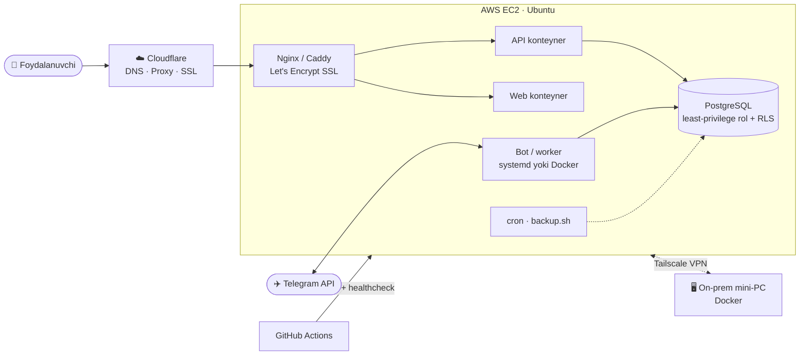

<div align="center">


<a href="https://git.io/typing-svg"></a>

<p>
<a href="mailto:ourty77@gmail.com"></a>
<a href="https://t.me/isroilovxk"></a>

</p>

</div>

---

```bash
root@draconuzb:~# cat /etc/profile.d/about.sh
```

```yaml
name:        Abduraxmon Isroilov
role:        Tizim administratori  # SysAdmin · IT-Infra · Security
location:    Toshkent, O‘zbekiston
experience:
  - 3y 7m   IT sohasida amaliy tajriba
  - 1y 6m   Tizim administratori  @ O‘zR Yoshlar ishlari agentligi
  - 2y 1m   O‘qituvchi / SysAdmin @ HAAD Learning Center (axborot xavfsizligi)
infra:       8+ loyihani AWS EC2 ga deploy qilib, production'da o‘zim yuritaman
education:   Turan International University — Software Engineering (4-kurs)
languages:   [ "O‘zbek — ona tili", "English — B2", "Русский — bazaviy" ]
mindset:
  - "Alomatni emas, asl sababni topaman"
  - "Takroriy ishni bir marta yozib, avtomatlashtiraman"
  - "Murakkab narsani oddiy tilda tushuntiraman"
```

## 🛡️ Nima bilan shug‘ullanaman

<table>
<tr>
<td width="50%" valign="top">

**🖥️ Tizimlar va infratuzilma**
- Windows / Linux serverlar va ish stansiyalari
- OS, drayver va dasturlarni o‘rnatish, sozlash, yangilash
- Server va servislar monitoringi, barqarorlik nazorati
- Hardware / software nosozliklarini topish va tuzatish
- Videokuzatuv va periferiya

</td>
<td width="50%" valign="top">

**🌐 Tarmoqlar**
- LAN, Wi-Fi, routerlar va tarmoq uskunalari
- Tarmoq diagnostikasi va muammolarni bartaraf etish
- VPN / overlay tarmoqlar (Tailscale, WireGuard)
- DNS, reverse proxy, SSL (Cloudflare, Let’s Encrypt)

</td>
</tr>
<tr>
<td width="50%" valign="top">

**🔐 Kiberxavfsizlik**
- Vulnerability assessment va penetration testing
- Recon / OSINT, web security testing
- CTF tayyorgarlik (OffSec Proving Grounds)
- Cybersecurity asoslaridan dars berish va mentorlik

</td>
<td width="50%" valign="top">

**⚙️ DevOps va avtomatlashtirish**
- Docker / Compose, systemd servislar, CI/CD
- AWS EC2 da production deploy va texnik xizmat
- Python va Bash bilan avtomatlashtirish
- AI vositalarini ish jarayoniga integratsiya

</td>
</tr>
</table>

## 🧰 Texnologiyalar

<div align="center">

**OS va infra**<br/>


**DevOps va cloud**<br/>


**Kod va ma’lumotlar bazalari**<br/>


<br/>


</div>

## ☁️ AWS va production serverlar

> Kod yozish bilan to‘xtamayman: serverni ko‘taraman, himoyalayman, deploy’ni avtomatlashtiraman, zaxira nusxa olaman va 24/7 ishlab turishini kuzataman.

<div align="center">

**🟢 Hozir ishlab turgan servislar (jonli status)**<br/><br/>
<a href="https://bizdaoson.uz"></a>
<a href="https://market.bizdaoson.uz"></a>
<a href="https://cybermentor.uz"></a>

</div>

**Men quradigan odatiy production arxitektura:**



**🔧 Amalda qo‘llaydigan ops amaliyotlari (kodda dalili bilan):**

| Amaliyot | Nima qilingan | Dalil |
|---|---|---|
| 🚀 **CI/CD** | `git push` → GitHub Actions → EC2 ga SSH → `docker compose build/up` → container **healthcheck**, healthy bo‘lmasa deploy fail bo‘ladi va log chiqadi | [deploy.yml](https://github.com/draconuzb/qoshni-taxi/blob/HEAD/.github/workflows/deploy.yml) · [crmpro](https://github.com/draconuzb/crmpro/blob/HEAD/.github/workflows/deploy.yml) |
| 🐳 **Konteynerlar** | Prod/dev uchun alohida compose, `restart` siyosati, healthcheck, izolyatsiyalangan network, log rotation | [compose.prod](https://github.com/draconuzb/qoshni-taxi/blob/HEAD/docker-compose.prod.yml) · [crmpro](https://github.com/draconuzb/crmpro/blob/HEAD/docker-compose.prod.yml) |
| ⚙️ **systemd** | Har bir servis alohida unit, alohida (root bo‘lmagan) user, `EnvironmentFile`, `Restart=always`, `NoNewPrivileges`, journald | [baxt-listener.service](https://github.com/draconuzb/baxt-cargo/blob/HEAD/deploy/baxt-listener.service) |
| 💾 **Backup** | Cron orqali har kuni ishlab turgan bazadan xavfsiz nusxa (`sqlite3 .backup`), gzip, 30 kunlik rotatsiya | [backup.sh](https://github.com/draconuzb/baxt-cargo/blob/HEAD/deploy/backup.sh) |
| 🔐 **DB xavfsizligi** | Ilova superuser bilan emas, minimal huquqli rol bilan ulanadi, shunda Row-Level Security haqiqatda ishlaydi (multi-tenant izolyatsiya) | [03-app-role.sh](https://github.com/draconuzb/gym-saas/blob/HEAD/backend/db/03-app-role.sh) |
| 🔒 **SSL / reverse proxy** | Nginx + certbot (HTTP→HTTPS redirect), Caddy bilan avtomatik HTTPS, WebSocket proxy, Cloudflare orqali | [enable-ssl.sh](https://github.com/draconuzb/gym-saas/blob/HEAD/enable-ssl.sh) · [Caddyfile](https://github.com/draconuzb/admin-market/blob/HEAD/deploy/Caddyfile) · [nginx](https://github.com/draconuzb/cybermentor.uz/blob/HEAD/config/nginx/cybermentor.conf) |
| 🛡️ **Server hardening + monitoring** | ufw (faqat 22/80/443), SSH uchun fail2ban, swap (OOM’dan himoya). O‘zim yozgan web-panel servislar holatini (nginx, code-server, fail2ban…) va bloklangan IP’larni ko‘rsatadi | [ctf_setup_ubuntu.sh](https://github.com/draconuzb/cybermentor.uz/blob/HEAD/ctf_setup_ubuntu.sh) · [dash_setup.sh](https://github.com/draconuzb/cybermentor.uz/blob/HEAD/dash_setup.sh) · [panel](https://github.com/draconuzb/cybermentor.uz/blob/HEAD/panel/app.py) |
| 🔁 **Migratsiya** | Taksi botlarini shared hostingdan (Alwaysdata) AWS EC2 ga ko‘chirdim (4 ta systemd servis). Xarajatni kamaytirish uchun servisni AWS dan on-prem mini-PC ga (Docker + Tailscale) o‘tkazdim | — |

## 🚀 Loyihalar

> Barcha loyihalarni o‘zim yozganman, serverga o‘zim chiqarganman va o‘zim boshqaraman: Linux server, Docker, Nginx, SSL, monitoring.

| Loyiha | Tavsif | Stack |
|---|---|---|
| 🚛 **[baxt-cargo](https://github.com/draconuzb/baxt-cargo)** | Furalar uchun AI yuk topish: Telegram guruhlarini kuzatadi, e’lonni parse qiladi, har bir mashina uchun kunlik sof marjani hisoblaydi (UZ ↔ RU reyslar) | Python · Telethon · SQLite · AI |
| 🚕 **[qoshni-taxi](https://github.com/draconuzb/qoshni-taxi)** | O‘zbekiston va Rossiya uchun taksi platformasi, menejer dashboard bilan. AWS EC2 da Docker, GitHub Actions orqali avtomatik deploy | Python · FastAPI · Docker · Telegram |
| 🎓 **[crmpro](https://github.com/draconuzb/crmpro)** | O‘quv markazlari uchun CRM: Telegram bot, AI analitika, web dashboard | NestJS · Prisma · Postgres · Docker |
| 🏪 **[admin-market](https://github.com/draconuzb/admin-market)** | Do‘konlar uchun B2B ulgurji bozor (API + mobil ilova) | FastAPI · Flutter · Postgres |
| 🏋️ **[gym-saas](https://github.com/draconuzb/gym-saas)** | Multi-tenant sport zal boshqaruv tizimi (production) | Node · Next.js · Postgres |
| 🛡️ **[cybermentor.uz](https://github.com/draconuzb/cybermentor.uz)** | CTF / kiberxavfsizlik o‘quv platformasi: brauzerdagi IDE va tayyor pentest tool’lar bilan | AWS · Cloudflare · Linux |
| 🤖 **[savebuilder](https://github.com/draconuzb/savebuilder)** | No-code Telegram bot fabrikasi, webhook multiplekser | aiogram · FastAPI · Postgres |
| 📚 **[aqilbek](https://github.com/draconuzb/aqilbek)** | Maktab o‘quvchilari uchun AI o‘quv yordamchisi | Next.js · Supabase · AI |

## 📊 GitHub statistikasi

<div align="center">


</div>

---

```bash
root@draconuzb:~# ./contact.sh
[+] Email     → ourty77@gmail.com
[+] Telegram  → @isroilovxk
[+] Status    → Yangi imkoniyatlarga ochiqman: SysAdmin / IT-Infra / Security
```


